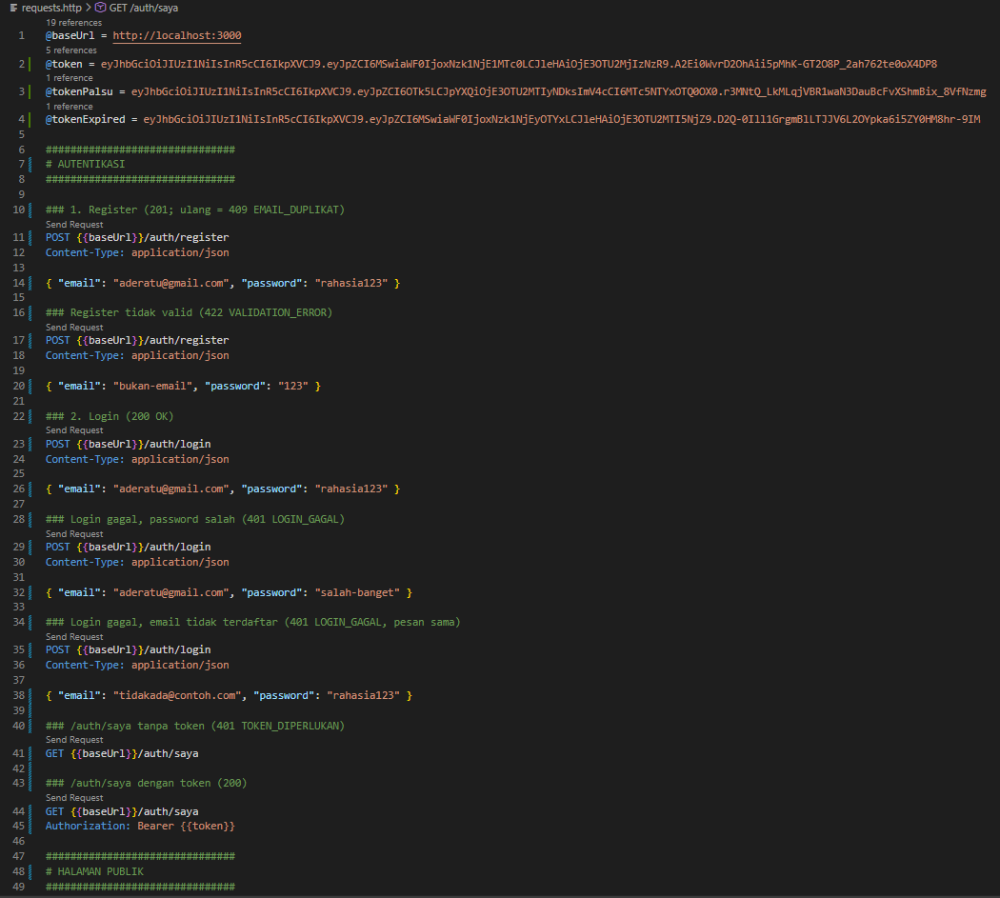
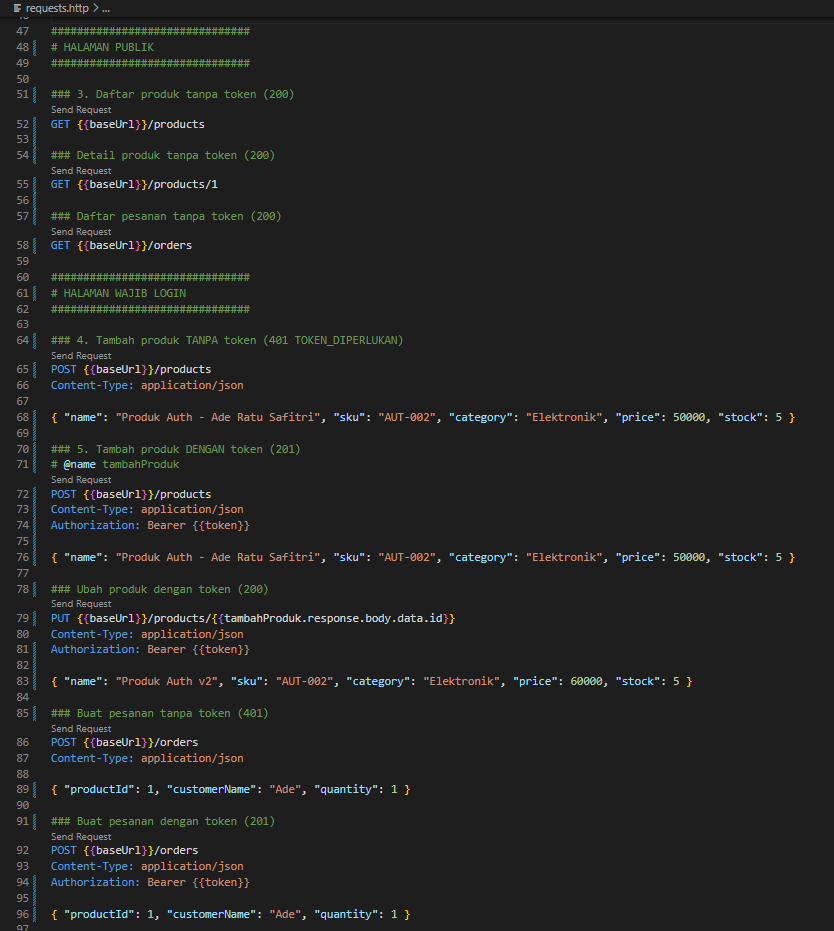
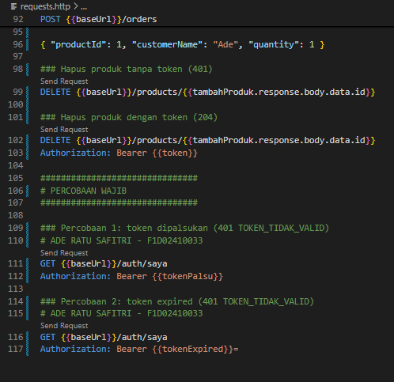

# Tugas 9 - Autentikasi & Otorisasi

Penambahan register, login (password di-hash bcrypt, token JWT), serta pembagian halaman publik dan wajib login pada proyek ETS (Products API).

## Identitas
- Nama : Ade Ratu Safitri
- NIM  : F1D02410033
- Kasus ETS : Products API (products dan orders)

## Cara Menjalankan
1. Clone repo, lalu jalankan `npm install`.
2. Salin `.env.example` menjadi `.env`, lalu isi `DATABASE_URL` dan `JWT_SECRET`.
   Secret acak bisa dibuat dengan:
   `node -e "console.log(require('crypto').randomBytes(32).toString('hex'))"`
3. Nyalakan MySQL dan buat database kosong bernama `products_db`.
4. Jalankan `npm run db:migrate`. Perintah ini membuat tabel `products`, `orders`, dan `users`.
5. (Opsional) Jalankan `npm run db:seed` untuk mengisi data produk awal.
6. Jalankan `npm run dev`. Server berjalan di http://localhost:3000.

## Akun Uji
Dibuat lewat endpoint `POST /auth/register` (tanpa seeder).

| Email | Password |
|-------|----------|
| aderatu@gmail.com | rahasia123 |

Password di atas hanya password sembarang untuk keperluan tugas.

## Struktur Proyek
```
src/
├── app.js                          (diubah: mount route /auth)
├── middleware/
│   ├── auth.js                     (BARU: butuhLogin, memeriksa token JWT)
│   ├── errorHandler.js             (diubah: format { error: { pesan, kode } })
│   └── validate.js                 (diubah: kode VALIDATION_ERROR)
├── routes/
│   ├── authRoutes.js               (BARU: /auth/register, /auth/login, /auth/saya)
│   ├── productRoutes.js            (diubah: butuhLogin di POST, PUT, DELETE)
│   └── orderRoutes.js              (diubah: butuhLogin di POST)
├── controllers/
│   ├── authController.js           (BARU: mengurus request/response auth)
│   └── productController.js        (diubah: kode error)
├── services/
│   ├── authService.js              (BARU: hash bcrypt dan pembuatan token JWT)
│   ├── productService.js           (diubah: kode error)
│   └── orderService.js             (diubah: kode error)
├── data/
│   └── userData.js                 (BARU: akses tabel users lewat Prisma)
├── validators/
│   └── authValidator.js            (BARU: validasi Joi register dan login)
└── utils/
    └── AppError.js                 (diubah: menambah properti kode)
prisma/
├── schema.prisma                   (diubah: menambah model User)
└── migrations/..._tambah_user/     (BARU: migrasi tabel users)
requests.http                       (diubah: pengujian autentikasi)
.env.example                        (diubah: menambah JWT_SECRET)
```

## Endpoint
| Method | URL | Akses | Status |
|--------|-----|-------|--------|
| POST | /auth/register | Publik | 201, 409 EMAIL_DUPLIKAT, 422 VALIDATION_ERROR |
| POST | /auth/login | Publik | 200, 401 LOGIN_GAGAL, 422 VALIDATION_ERROR |
| GET | /auth/saya | Wajib login | 200, 401 |
| GET | /products | Publik | 200 |
| GET | /products/:id | Publik | 200, 400, 404 |
| POST | /products | Wajib login | 201, 401, 409, 422 |
| PUT | /products/:id | Wajib login | 200, 400, 401, 404, 409, 422 |
| DELETE | /products/:id | Wajib login | 204, 400, 401, 404, 409 |
| GET | /orders | Publik | 200 |
| POST | /orders | Wajib login | 201, 401, 404, 409, 422 |

Format error seragam: `{ "error": { "pesan": "...", "kode": "..." } }`.
Kode untuk token: `TOKEN_DIPERLUKAN` (header tidak ada atau bukan Bearer) dan `TOKEN_TIDAK_VALID` (token rusak, signature salah, atau expired).

## Pengujian
Tabel `users` di phpMyAdmin. Kolom `passwordHash` berisi hash bcrypt, bukan password asli:


Halaman publik (kiri) bisa dibuka tanpa token, sedangkan halaman wajib login (kanan) ditolak tanpa token:

| Request 3: GET /products tanpa token (200) | Request 4: POST /products tanpa token (401) |
|---|---|
|  |  |

Request 5: POST /products dengan token berhasil (201):


File `requests.http` di VS Code:





## Dua Percobaan

### Percobaan 1: Token dipalsukan
Setelah login, payload token diubah (`id` menjadi 999) tanpa mengetahui secret, lalu dikirim ke `GET /auth/saya`. Hasilnya 401 `TOKEN_TIDAK_VALID`.


Penjelasan: JWT terdiri dari header, payload, dan signature. Payload hanya di-encode Base64, tidak dienkripsi, sehingga siapa saja bisa membaca dan mengubahnya. Namun signature dihitung dari header dan payload memakai `JWT_SECRET` yang hanya diketahui server. Ketika payload diubah, signature lama tidak lagi cocok dengan hasil hitung ulang server, sehingga `jwt.verify` gagal dan permintaan ditolak. Pemalsu tidak bisa membuat signature baru yang benar tanpa secret.

### Percobaan 2: Token expired
`expiresIn` diubah sementara menjadi `'5s'`, login, menunggu 6 detik, lalu request dikirim ke `GET /auth/saya`. Hasilnya 401 `TOKEN_TIDAK_VALID`. Setelah percobaan, `expiresIn` sudah dikembalikan ke `'2h'`.


Penjelasan: Saat token dibuat, waktu kedaluwarsanya (`exp`) ikut ditulis di dalam payload dan dilindungi signature. Ketika token dikirim, `jwt.verify` membandingkan `exp` dengan waktu saat ini, dan menolak token bila sudah lewat. Karena informasi waktunya ada di dalam token itu sendiri, server tidak perlu menyimpan catatan apa pun. `exp` juga tidak bisa diubah tanpa merusak signature.

## Deklarasi Penggunaan AI

| Bagian | Alat AI | Dipakai untuk apa | Cara saya memeriksa hasilnya |
|--------|---------|-------------------|------------------------------|
| Format error seragam | Claude | Kode AppError, errorHandler, validate, dan kode error di service | Menjalankan GET /products/999 dan /products/abc, lalu memeriksa bentuk error |
| Tabel users + migrasi | Claude | Model Prisma User dan perintah migrasi | Memeriksa tabel dan kolom di phpMyAdmin |
| Register dan login | Claude | Validator Joi, service bcrypt dan JWT, controller, route | Menguji 201, 409, 422, 200, dan 401 (password salah dan email tidak terdaftar); memeriksa hash di phpMyAdmin |
| butuhLogin dan /auth/saya | Claude | Middleware pembaca header Bearer dan jwt.verify | Menguji tanpa token, token rusak, header Basic, dan token valid |
| Pembagian publik dan wajib login | Claude | Pemasangan butuhLogin di route products dan orders | Menguji semua endpoint dengan dan tanpa token |
| requests.http dan dua percobaan | Claude | Isi requests.http dan cara memalsukan token | Menjalankan semua request dan mencocokkan status yang diharapkan |

Contoh prompt: "claude bantu aku kerjain bagian ini step by step aja ya"

Pernyataan: Saya menggunakan AI (Claude) pada bagian yang tertulis di tabel. Proyek ETS dasar, pengujian, dan pengambilan screenshot saya kerjakan sendiri.

## Kesimpulan & Kendala

**1. Kenapa password di-hash, bukan dienkripsi?**
Hash bersifat satu arah, dari hash tidak bisa dikembalikan ke password asli. Enkripsi bersifat dua arah, siapa pun yang memegang kunci bisa membukanya, sehingga jika database dan kunci bocor, semua password ikut terbuka. Server juga tidak perlu mengetahui password asli, cukup membandingkan password yang dikirim dengan hash tersimpan memakai `bcrypt.compare`. bcrypt memakai salt dan cost 10 sehingga password yang sama menghasilkan hash berbeda dan serangan tebak-tebakan menjadi lambat.

**2. Kenapa pesan login gagal dibuat sama untuk email tidak terdaftar dan password salah?**
Jika pesannya berbeda, penyerang bisa mencoba banyak email dan mengetahui mana yang terdaftar, lalu fokus menebak password email tersebut. Dengan pesan yang sama ("Email atau password salah"), penyerang tidak mendapat petunjuk apa pun.

**3. Apa bedanya halaman publik dan wajib login, dan dari mana server tahu token sah tanpa menyimpannya?**
Halaman publik (register, login, `GET /products`, `GET /products/:id`, `GET /orders`) bisa dibuka siapa saja karena tidak dipasangi `butuhLogin`. Halaman wajib login (`/auth/saya`, `POST/PUT/DELETE /products`, `POST /orders`) melewati `butuhLogin` yang memeriksa header `Authorization: Bearer`. Server mengetahui token sah lewat `jwt.verify`: menghitung ulang signature dengan `JWT_SECRET`, membandingkannya dengan signature di token, dan memeriksa `exp`. Karena semua informasi ada di dalam token, server tidak perlu menyimpan token di database.

**Kendala dan solusi**
- Format error pada proyek ETS (`{ status, pesan }`) berbeda dari yang diminta tugas (`{ error: { pesan, kode } }`). Solusinya, `AppError` diberi properti `kode`, lalu `errorHandler`, `validate`, dan semua `throw new AppError` disesuaikan.
- Pada Percobaan 2, `expiresIn` harus diubah sementara menjadi `'5s'` dan wajib dikembalikan ke `'2h'` sebelum commit. Solusinya, nilai itu diperiksa kembali sebelum `git commit`.